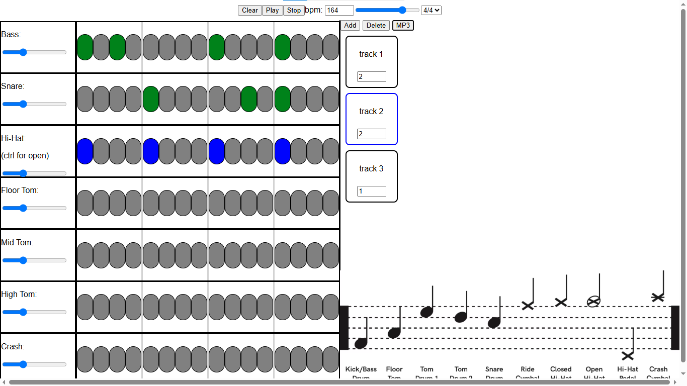

# Drumming Machine

### Description
This is a personal project related to my music interest. Since I play guitar I'd love to cover my favorite songs. To try keep in track I wanted to make a drumming machine so I could better practice pieces. 

Program is separated into tracks defined by an instrument in the drum kit. Clicking the nodes allows you to place a note, which can then be played either using space or the play button at the top

Each track has a slider to change how loud each instrument is in the mix

Using the javascript Audio API I can then play the pieces of the drumkit through the browser. Using the bpm and the time signature it plays the instruments together to act like a drumkit.

On the other side of the screen you can make tracks which allows you to change the rhythm. The number on each track allows you to change how many bars the rhythm is playing for

Holding ctrl and pressing the play button plays the tracks together and continuously loops the track.

Using the add you can add tracks. Delete button will delete the track that is selected. Clicking on the track selects them and each beat is saved in the track. 

Reason there is a server involved with this project I decided that I wanted to write my own export function. I was reading how to construct your own files as I was interested in the actual data that gets saved into a file.

https://docs.fileformat.com/audio/wav/

https://www.mmsp.ece.mcgill.ca/Documents/AudioFormats/WAVE/WAVE.html

Following the readings of these documents and writing a test file in python I was able to use the tracks to then make the track. If I wanted to cover songs then I'd need to use the audio to then put into audacity.

The server opens each of the files and saves the raw data. 

The meta data is constructed first and the data is constructed byte by byte using the timings of the track to then make the file. The file exports as a WAV file which can then be saved to your computer

If two or more instruments play at the same time then I would have to combine both of the audios. This is done by adding the signal values together. I then have to worry about audio clipping out of the bounds of the specified bit-depth of the file

The audio signal then gets divided by how many sounds are being played together. A test audio can be heard below:

### Usage
Ensure that you have Node.js initialised on your computer. 
install socket.io.

npm install socket.io

Clone this repositiory into your own directory. Open a terminal at project directory

node index.js 

will run the program. Keeping the terminal open will allow the program to run. In the browser go into the localhost at the port specified in the console.

localhost:3000
